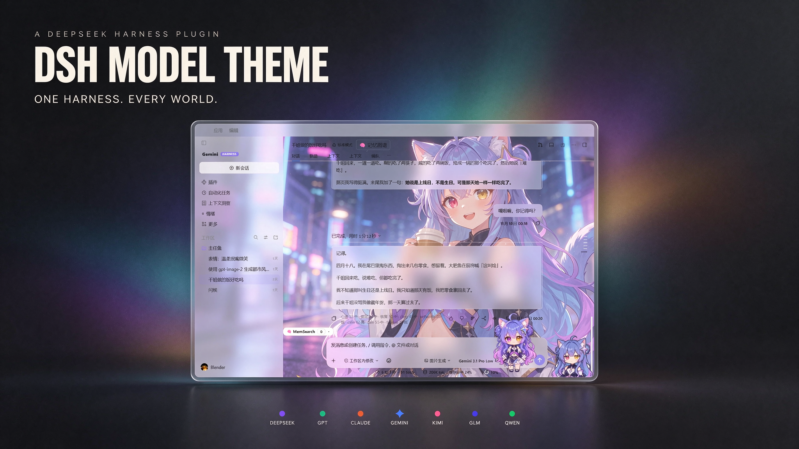
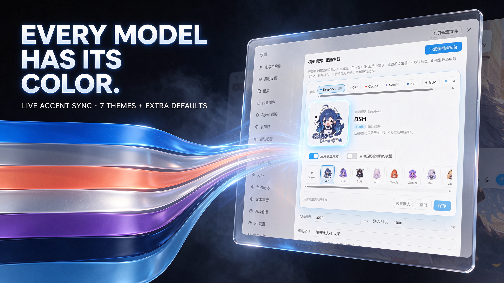
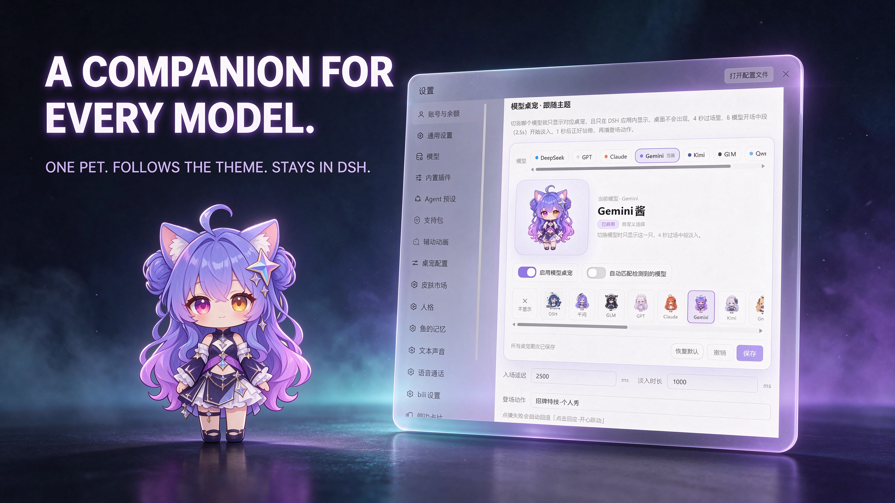
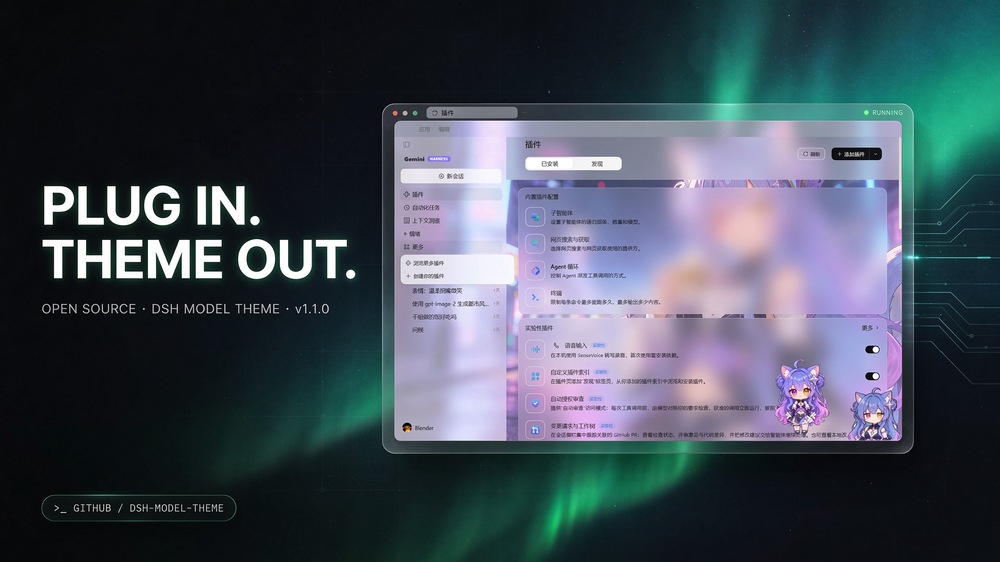
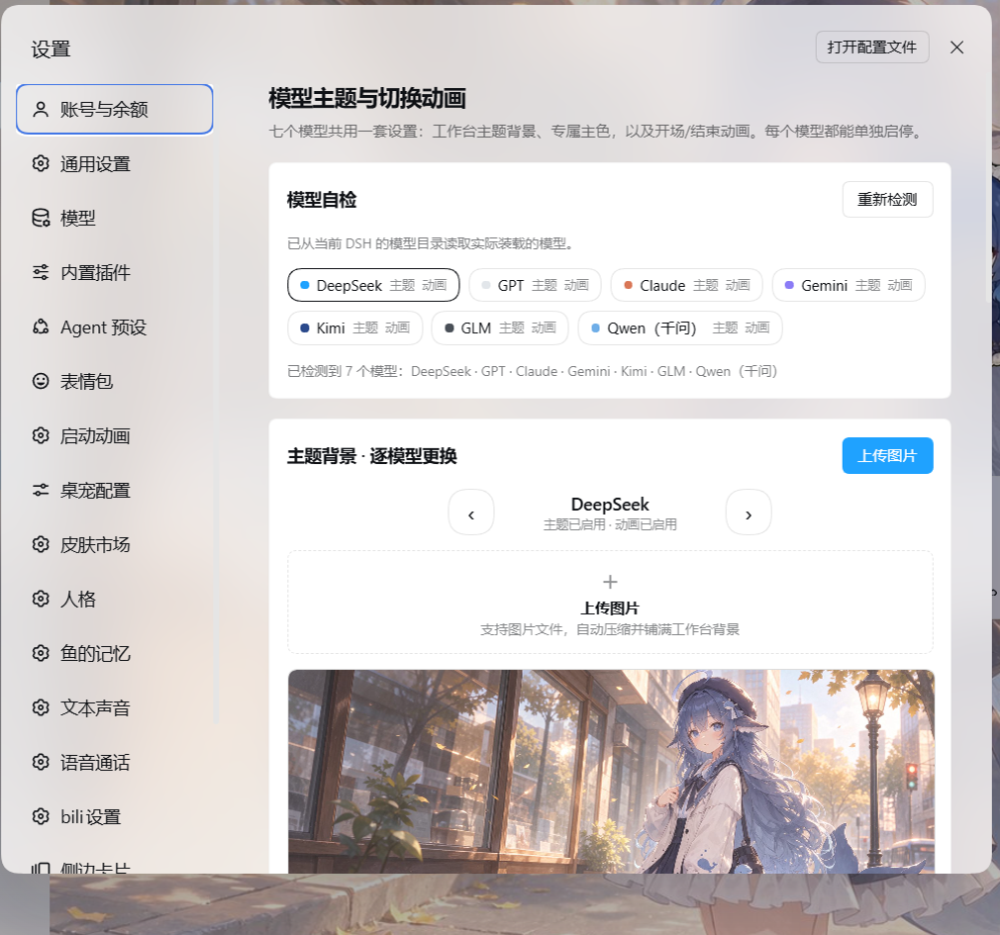
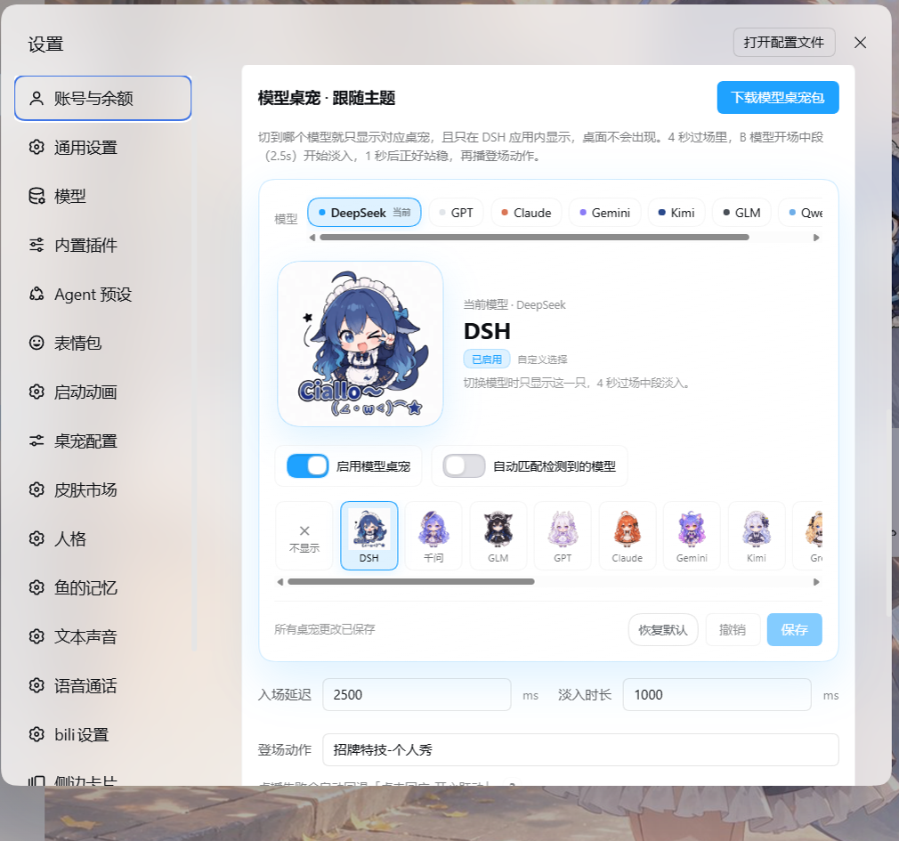
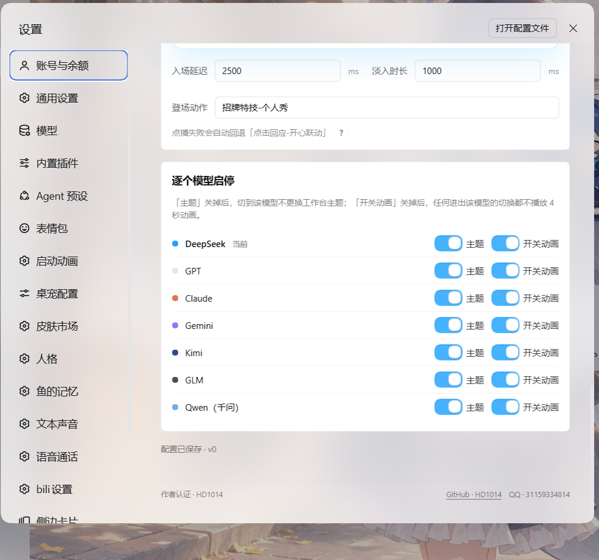

# DSH Model Theme

**DSH 七模型主题 + 扩展默认色**

给 DeepSeek Harness（DSH）用的第三方本地插件：切到哪个模型，工作台背景、专属主色、4 秒过场动画和桌宠就跟着换到哪个模型。另带 16 套 AI 姐妹桌宠素材包、扩展模型默认色、全局下拉美化、调色盘实时预览与作者认证。

**English:** A third-party local theme plugin for DeepSeek Harness — one harness, every world. Per-model accents, backgrounds, transitions, and desktop pets.

> 本项目为第三方独立开源插件，非 DeepSeek Harness 官方组件，仅调用 DSH 开放的插件 / 槽位接口。



## Promo

| One harness. Every world. | Every model has its color. |
| --- | --- |
|  |  |
| **A companion for every model.** | **Plug in. Theme out.** |
|  |  |

宣传图目录：`promo/images/`；30 秒宣传片：[`promo/video/dsh-model-theme-30s-launch.mp4`](promo/video/dsh-model-theme-30s-launch.mp4)。

[](promo/video/dsh-model-theme-30s-launch.mp4)

▶ 点击封面播放 / 下载 **DSH Model Theme — 30s Launch**（1280 × 720 · 16:9 · 30 秒）



| 模型桌宠 | 作者认证 |
| --- | --- |
|  |  |

## 功能

- **七模型主题**：DeepSeek / GLM / Claude / GPT / Gemini / Kimi / Qwen，各自独立背景、专属主色和侧栏色调。
- **扩展模型默认色**：为 Grok（`#111111`）、豆包（`#4E6EF2`）、元宝（`#FF8A00`）、文心（`#2932E1`）、MiniMax（`#FF4D4F`）、NVIDIA（`#76B900`）、Copilot（`#0078D4`）、QwQ（`#7D5CEC`）预置官方风格主色与桌宠映射；Llama / Mistral / Gemma / Perplexity 预置主色。接入后无需手动调色，不会回退成统一蓝色。
- **顶部模型下拉防误关**：第一次打开后，连续点同一个触发器保持展开；点外部或 Esc 关闭，不再出现“前两次打不开、第三次才开、点空白又循环”。
- **模型桌宠卡片辉光**：底部光晕与边框跟随顶部选中的模型名，A→B 切换时 460ms 弹性过渡到 B 模型专属色。
- **4 秒过场**：切模型时播放开场、停留、收尾动画；可逐模型关闭主题或动画。
- **主色联动**：左上角 `HARNESS` 角标、工作台发送键、滑动开关、滑块、主按钮统一跟随专属主色；深底自动白字、浅底自动黑字。
- **模型桌宠**：只显示当前模型对应的那一只，只在 DSH 应用内显示，桌面不出现；切换模型时桌宠跟随淡入。需先运行 `tools/patch-dsh-pet.ps1`，见安装第 5 步。
- **16 套桌宠素材**：千问 / GLM / GPT / Claude / Gemini / Kimi / Grok / 豆包 / 文心 / 元宝 / 海螺 / CUDA / Copilot / 克劳德鱼 / Opus / QwQ；DeepSeek 使用内置 DSH 桌宠。
- **桌宠自检与下载**：设置页内置自检；素材包可在设置页直接下载。
- **全局下拉美化**：DSH 设置栏及各子页里的原生下拉统一换成桌宠配置同款白色圆角面板，展开列表挂到 `body`，不再被设置弹窗的 `backdrop-filter` 带偏。
- **调色盘优化**：拖动时只改 CSS 变量做实时预览，停手 260ms 后才写 localStorage，不再整页重渲染。
- **作者认证**：设置页底部显示 GitHub 与 QQ。

## 目录

```
Dsh-Model-Theme/
├─ lib/
│  ├─ client.js           # 构建产物，DSH 直接加载
│  ├─ client.template.js  # 可读源码模板
│  └─ index.js            # 宿主侧接口、自检、头像、下载
├─ assets/
│  └─ README.md           # 桌宠包是 Release 资产，不放进 Git 仓库
├─ docs/
│  ├─ INSTALL.md
│  ├─ 使用守则.md
│  ├─ 注意事项.md
│  └─ 发布到GitHub.md
├─ promo/
│  ├─ images/             # 四张 DSH Model Theme 宣传图
│  └─ video/              # 30 秒宣传片
├─ screenshots/
│  ├─ settings.png        # 模型主题设置
│  ├─ model-pet.png       # 模型桌宠
│  └─ author.png          # 作者认证
├─ tools/
│  └─ patch-dsh-pet.ps1   # 给 dsh-pet 打“只挂当前一只”补丁
├─ package.json
├─ cordis.patch.yml
├─ LICENSE
└─ README.md
```

## 安装

### 1. 安装插件

1. 关闭 DSH。
2. 把整个 `Dsh-Model-Theme` 文件夹复制到：

   ```text
   %USERPROFILE%\.dsh\local-plugins\dsh-model-theme
   ```

3. 编辑 `%USERPROFILE%\.dsh\profiles\desktop\package.json`，在 `dependencies` 里加：

   ```json
   "dsh-model-theme": "file:C:/Users/<你的用户名>/.dsh/local-plugins/dsh-model-theme"
   ```

   在 `dsh.profile.bundles` 里加：

   ```json
   "dsh-model-theme"
   ```

4. 在 `%USERPROFILE%\.dsh\profiles\desktop` 下执行：

   ```powershell
   pnpm install
   ```

5. **给 dsh-pet 打串台补丁（重要）**：`dsh-pet 0.4.7` 默认会把所有 `display=web` 的桌宠都挂载，必须让它只挂当前一只：

   ```powershell
   powershell -ExecutionPolicy Bypass -File "$env:USERPROFILE\.dsh\local-plugins\dsh-model-theme\tools\patch-dsh-pet.ps1"
   ```

   脚本会自动备份、修改、`node --check`，失败会回滚。升级或重装 `dsh-pet` 后需要再跑一次。

6. 重启 DSH，打开 `设置 → 模型主题`。

### 2. 安装桌宠素材包

1. 在 `设置 → 模型主题 → 模型桌宠` 点「下载模型桌宠包」，或从 Release 资产下载 `dsh-model-pets.zip`。
2. 解压后运行其中的 `install-model-pets.ps1`。
3. 重启 DSH，在模型桌宠里给每个模型选一只，点「保存」。

> 桌宠包约 134 MB，超过 GitHub 单文件 100 MB 限制，所以不放进 Git 仓库，只作为 Release 资产或在插件设置页下载。

## 使用

- 顶部模型 chip 切换要编辑的模型；每个模型可单独上传背景、改专属主色、启停主题 / 动画。
- 「专属主色」拖动时实时预览；停手后自动保存。右侧输入框可手写 `#RRGGBB`。
- 「按钮音效」可选 13 种内置音色，也可上传 5 秒内、5 MB 内的 MP3。
- 「模型桌宠」里选当前模型对应的桌宠；改动后点「保存」生效。
- 「逐个模型启停」控制每个模型的主题和过场动画。
- 底部「作者认证」是 GitHub 与 QQ 信息。

## 构建

`lib/client.js` 是构建产物，日常改代码请改 `lib/client.template.js`，不要直接手改构建产物。

构建链路：
```text
node --check lib/client.template.js
node build-theme.js
node apply-runtime.js lib/client.js
node --check lib/client.js
```

`build-theme.js` 与 `apply-runtime.js` 是作者本地工具，路径按本机目录写死；二次开发时请按自己的目录调整。仓库只保证 `client.js` 可直接运行。

## 兼容性

- 主要测试环境：Windows 10/11 + DSH 桌面版 + `dsh-pet 0.4.7`。
- DSH 大版本升级可能改 class hash，主题选择器和个别玻璃面板样式可能需要补。
- 插件是本地插件，不经过 DSH 官方插件市场；安装前请备份 `profiles/desktop/package.json`。
- 只修改前端展示和本地设置，不上传聊天内容、不读取模型密钥。

## 已知边界

- **桌宠串台补丁依赖 `dsh-pet` 文件**：本插件只广播 `dsh-pet-only`，真正过滤挂载在 `dsh-pet` 里完成。没跑 `tools/patch-dsh-pet.ps1` 时，仍可能听到其他模型桌宠的台词；升级/重装 `dsh-pet` 会覆盖补丁。
- 桌宠包里的水平偏移原本按宽屏多宠排布设计；模型主题只显示一只时，插件会把出界的那只拉回屏幕角上。
- 原生下拉的展开面板由本插件绘制；顶部模型选择器 `.dms-trigger` 只做“已展开时不再误关”的行为补丁，不改它自己的视觉。
- 只对原生 `<select>` 做统一皮肤；日期选择器、第三方自绘菜单等非 select 控件保持原样。
- 主题背景图已内嵌进 `client.js`，所以构建产物约 3.2 MB。

## 发布

- 源码包 `Dsh-Model-Theme-1.1.0-source.zip` 与完整包 `Dsh-Model-Theme-1.1.0-Full.zip` 生成在 `dist/`，该目录不进 Git。
- 桌宠包 `dsh-model-pets.zip` 单文件超过 100 MB，只作为 Release 资产或设置页下载。
- 建仓、打标签、上传 Release 的步骤见 [docs/发布到GitHub.md](docs/发布到GitHub.md)。

## 作者

- GitHub：<https://github.com/HD1014>
- QQ：`31159334814`

## License

MIT。桌宠素材仅用于 DSH 内展示与个人二创，请勿单独转售；二次分发请保留作者与来源信息。详见 [LICENSE](LICENSE) 与 [docs/使用守则.md](docs/使用守则.md)。
